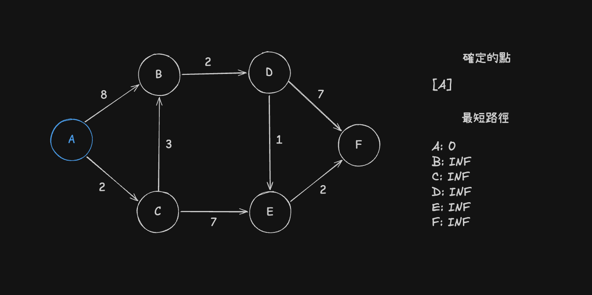
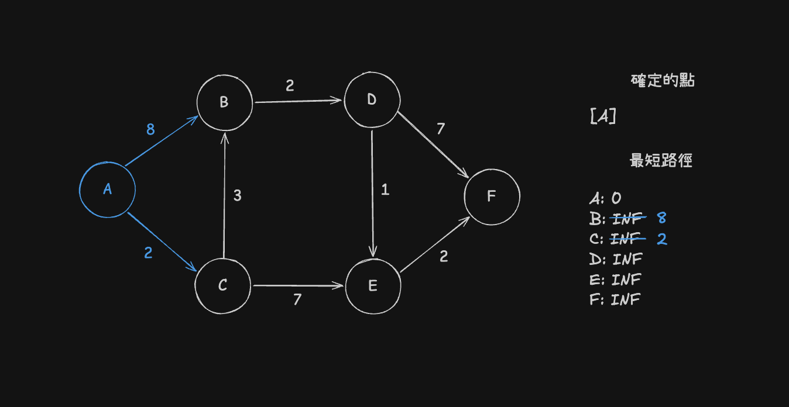
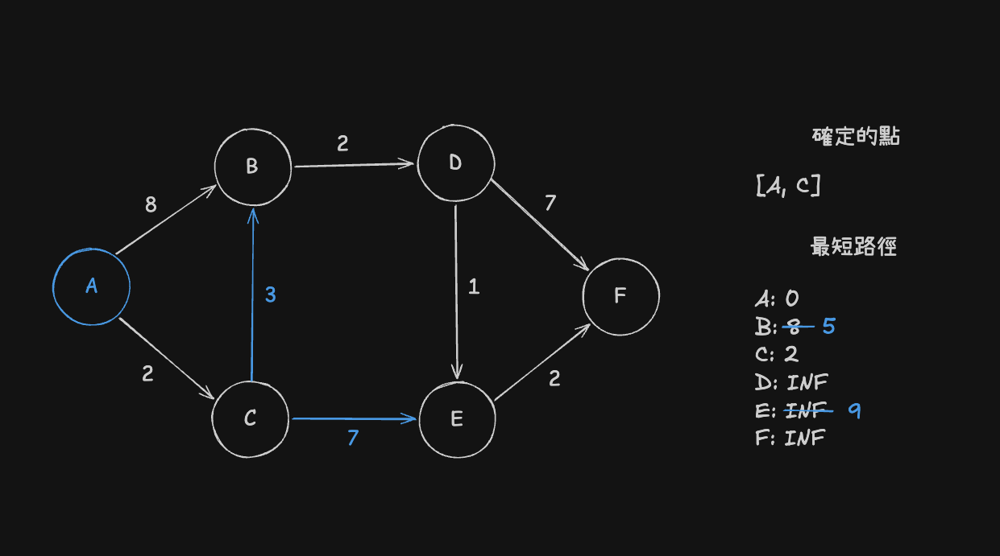
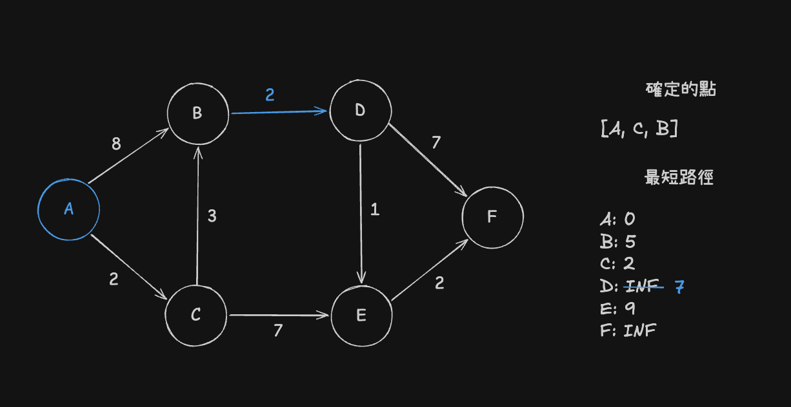
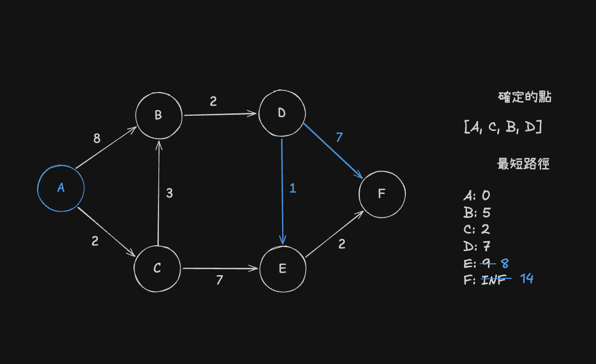
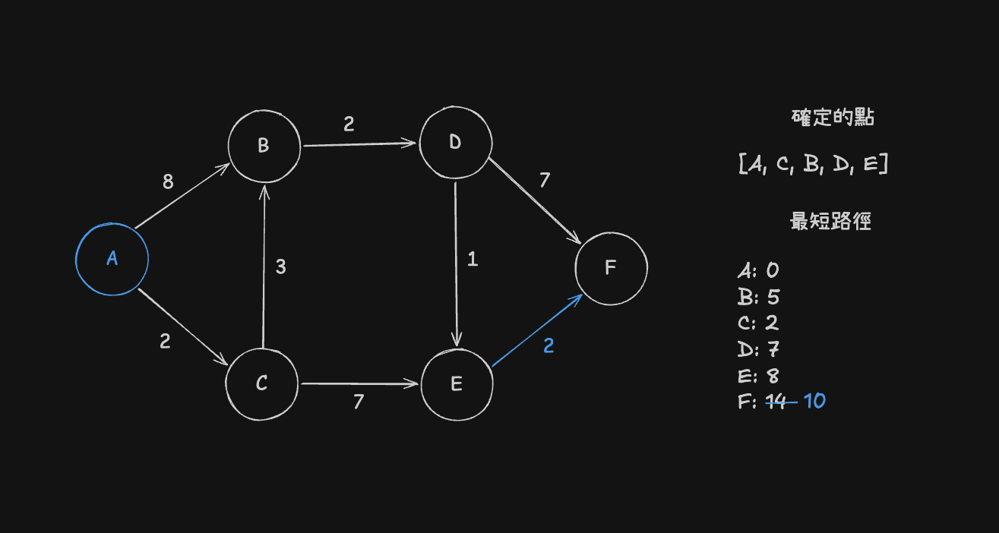

Dijkstra 可以在一個圖中找出一個點到其他所有點的最短距離，只要沒有負權重的邊。

> 註: Dijkstra 是荷蘭名字，讀法類似英文 dike-stra

## 概念

首先選擇一個起點，將距離設為 $0$，其他點的距離記為無限大

注意距離都是起點到那一個點的距離

接著，重複以下的步驟：

1. 在還不確定最短距離的點中，選擇目前距離最小的點
2. 確定這個點的最短距離
3. 檢查與這個點連接的點，如果經過這個點可以讓距離縮短，就更新距離

直到所有點都檢查完，便完成了，如果有點還是無限大，就代表一定到不了

因為邊的權重不是負的，經由還不確定的點繞路，不可能比目前最小的距離更小，所以會成立，也因為這樣有負權重的圖就不可以用 `dijkstra`

## 範例

現在有一個圖，如下，以 $A$ 為起點



首先先檢查 $A$ 附近的邊: $A-B$ 和 $A-C$ 



在還沒有確定最短距離的點中 $C$ 的距離最短，所以接下來看 $C$ 附近的點，$A-C-E$ 和 $A-C-B$ 

$A-C-E$ 距離為 $2+7=9$ 

$A-C-B$ 距離為 $2+3=5$

因為 $B, E$ 點原本距離都比較遠，所以兩個都更新



繼續，目前不確定的點，$B$ 距離 $5$ 最短，看 $B$ 連接的點，有一個 $A-C-B-D$，距離為 $5+2=7$



剩下還沒確定最短距離的點 $DEF$ 中，最近的為 $D$，看他附近的點

$A-C-B-D-E$ 為 $7+1=8$

$A-C-B-D-F$ 為 $7+7=14$ 

都比之前的小，更新



剩下 $E, F$ 點，$E$ 點較近

$A-C-B-D-E-F$ 距離為 $8+2=10$ 

比之前的 $14$ 小，更新 $F=10$



這時只剩下 $F$ 還沒有檢查，檢查發現沒有邊可以走，結束

所以 $A$ 到 $B, C, D, E, F$ 最短距離為 $5, 2, 7, 8, 10$

## 實作

實作時，我們會用一個 `set` 來記錄確定的點，並用 `priority_queue` 來找接下來最短要檢查的 

以 [CSES - Shortest Routes I](https://cses.fi/problemset/task/1671) 為例

### 題目

有 $n$ 個城市和 $m$ 個航線連接著城市

你的目標是找出從台北到其他每個城市的最短距離

### 輸入

第一行有兩個數字 $n, m$ 城市的數量以及航線數量，城市編號從 $1, 2, 3, 4, ... ,n$，城市 $1$ 是台北

接下來有 $m$ 行，每一行有三個數字 $a, b, c$，表示一個航線從城市 $a$ 到城市 $b$，距離 $c$ ，每個航線都是單向的

### 輸出

輸出 $n$ 個數字

分別是從台北到城市 $1, 2, 3, 4, ... ,n$ 的最短距離

### 範圍

$1 \le n \le 10^5$

$1 \le m \le 2 \times 10^5$

$1 \le a, b \le n$

$1 \le c \le 10^9$

### 範例

輸入
```
3 4
1 2 6
1 3 2
3 2 3
1 3 4
```

輸出
```
0 5 2
```

### 程式

```cpp=
#include <bits/stdc++.h>
using namespace std;

using ll=long long;
using pll=pair<ll, ll>;

int main() {
    ios::sync_with_stdio(false);
    cin.tie(nullptr);

    int N, M; cin>>N>>M;

    vector<vector<pll>> f(N); // 儲存所有的邊 {終點, 距離}

    for (int i=0; i<M; i++) {
        int s, e, c; cin>>s>>e>>c;
        s--; e--;
        f[s].push_back({e, c});
    }

    vector<ll> dp(N, LLONG_MAX); // 台北到該城市目前的最短距離
    dp[0]=0;

    priority_queue<pll, vector<pll>, greater<pll>> pq; // {距離, 城市}，距離小的在前面
    pq.push({0, 0});

    set<int> visited; // 已經確定最短距離的城市

    while (!pq.empty()) {
        // 1. 在還不確定的城市中，選擇目前距離最小的
        auto [c, pos]=pq.top();
        pq.pop();

        if (visited.count(pos)) continue; // 已經確定過，是舊的資料，跳過

        // 2. 確定這個城市的最短距離
        visited.insert(pos);

        // 3. 檢查相連的城市，如果經過這裡比較近，就更新距離
        for (auto [nxt, w] : f[pos]) {
            if (dp[pos]+w < dp[nxt]) {
                dp[nxt]=dp[pos]+w;
                pq.push({dp[nxt], nxt});
            }
        }
    }

    for (int i=0; i<N; i++) {
        cout<<dp[i]<<' ';
    }
    cout<<'\n';

    return 0;
}

```