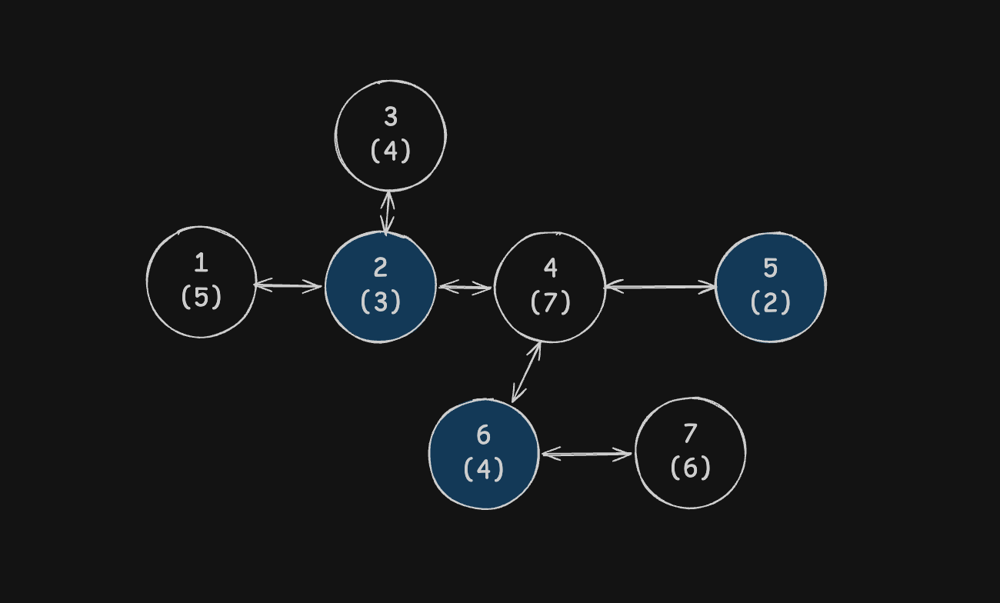
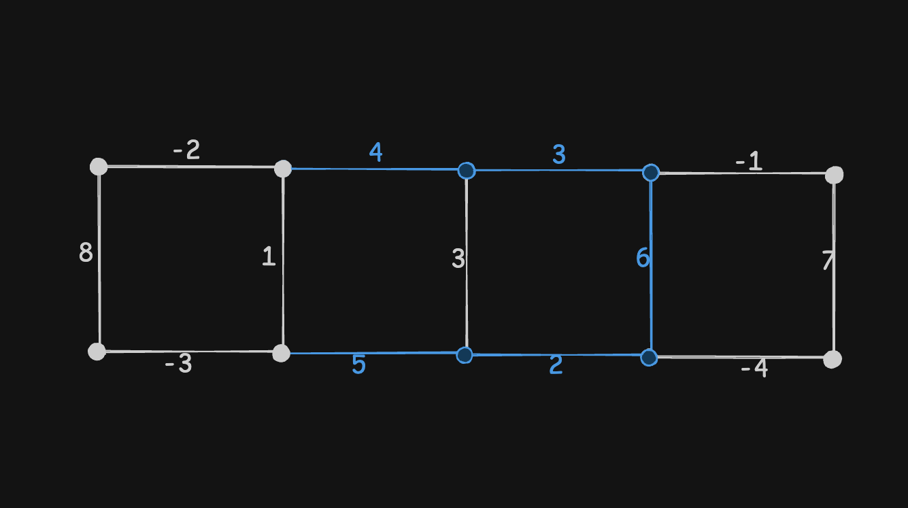

並非官方解答或題本，是考後根據記憶寫下，省略了許多的題目故事，可能會不完整，或有些許錯誤。

程式沒有辦法確定一定對，而且我比賽中也沒有寫出來，所以也不確定到底實際有沒有 AC，有問題私我

## Q1

### 題目

給你 $N$ 個城市，每個城市編號從 $1$ 到 $N$，你要在一些城市興建建築，在城市 $i$ 建立的成本為 $C_i$

同時有 $N-1$ 條道路存在，一條道路連接兩個城市，這些道路讓所有的城市互相連通

對每一座城市而言，它本身或是至少一個與它直接相鄰的城市上要有建築物

求最少需要花多少成本達成條件

### 輸入

第一行為一個整數 $N$ ，城市的數量

第二行有 $N$ 個數，分別為 $C_1、C_2、C_3、...、C_N$ ，為每城市建造建築物需要的成本

接下來有 $N-1$ 行，每行兩個數 $u, v$ ，是該道路兩端所連接的城市

### 輸出

輸出一個數: 在城市上建造建築物，使其符合條件，最少需要的花費

### 範圍 

$2 \le N \le 2 \times 10^5$

$0 \le C_i \le 10^4$ ( $1 \le i \le N$ )

### 範例

Input
```
7
5 3 4 7 2 4 6
1 2
2 3
2 4
4 5
4 6
6 7
```

Output
```
9
```

在城市 $2, 5, 6$ 興建，總成本為 $3 + 2 + 4 = 9$

如下圖，括號內為該城市花費，藍色為選擇的城市



### 思路

因為有 $N$ 座城市，$N-1$ 條道路，而且全部都連通，所以會形成一棵樹

我們選一點來當作根，從最下面往上算。處理城市 `u` 時，先假設下面的城市都算好了，再來決定 `u` 要怎麼滿足條件

對 `u` 記錄三種情況下的最低成本: 

- `dp[u][0]` 為自己蓋
- `dp[u][1]` 為自己不蓋，至少一個子蓋
- `dp[u][2]` 為自己不蓋，假設父會蓋

成本都包含 `u` 以及所有下面的城市，不包含父，在第三種先記下來，只有在父蓋時才會用

如果 `u` 自己蓋，也能照顧子，所以每個子都可以自由選這三個情況，把每個子最便宜的成本加在一起，再加上 `u` 本身的費用，設為 `dp[u][0]` ，為程式中的 `build`

如果 `u` 不蓋，子不能依靠它，所以子只能選自己蓋或是由自己的子照顧，先把兩者較小的成本加起來，得到 `base` 。若 `u` 的父會蓋，`u` 變有人照顧， `dp[u][2]=base` 

但如果 `u` 要靠子照顧，就必須要確保至少一個子會自己蓋， `base` 原本可能所有子都沒有蓋，強制其中一個子改成自己蓋，所以挑多付最少的，記錄為 `extra` ，因此 `dp[u][1]=base+extra`

> time: $O(N)$ \
> space: $O(N)$

### 程式

```cpp=
#include <bits/stdc++.h> 
using namespace std;

using ll = long long;

int main() {
    ios::sync_with_stdio(false);
    cin.tie(nullptr);

    int N;
    cin>>N;

    vector<ll> cost(N);
    for (ll& c : cost) cin>>c;

    vector<vector<int>> adj(N);
    for (int i=0; i<N-1; ++i) {
        int u, v; cin>>u>>v;
        --u; --v;
        adj[u].push_back(v);
        adj[v].push_back(u);
    }

    const ll INF=1LL<<60;

    // 先記錄父與走訪順序
    // 反過來處理時，子一定已經算完
    vector<int> parent(N, -1), order;
    order.reserve(N);
    parent[0]=0;
    order.push_back(0);

    for (int i=0; i<N; ++i) {
        int u=order[i];
        for (int v:adj[u]) {
            if (v==parent[u]) continue;
            parent[v]=u;
            order.push_back(v);
        }
    }

    // 0: 自己蓋 1: 自己不蓋、至少一個子蓋；2: 自己不蓋、父蓋
    // 2 仍允許子蓋，只是使用它時必須保證父有蓋
    vector<array<ll, 3>> dp(N);

    for (int i=N-1; i>=0; --i) {
        int u=order[i];
        ll build=cost[u], base=0, extra=INF;

        for (int v : adj[u]) {
            if (parent[v]!=u) continue;

            build+=min({dp[v][0], dp[v][1], dp[v][2]});

            ll best=min(dp[v][0], dp[v][1]);
            base+=best;
            extra=min(extra, dp[v][0]-best);
        }

        dp[u][0]=build;
        dp[u][1]=base + extra;
        dp[u][2]=base;
    }

    // 根沒有父，無法使用狀態 2
    cout<<min(dp[0][0], dp[0][1])<<'\n';
}
```

## Q2

> 這題好像叫曼哈頓觀光？

### 題目

平面上，總共有 $N \times M$ 個點，共有 $M$ 列，每一列有 $N$ 個點

左右相鄰、上下相鄰的點之間各有一條邊，你有每一個邊的受歡迎程度 $k$

你可以任意選擇一個起點及一個終點

在不經過重複的邊的情況下，從起點走到終點，每次可以往左、右、下，唯獨不能往上走

經過的所有邊，其受歡迎程度總和最大為多少?

> 這題他好像沒有寫到可不可以起點終點相同，這邊是以可以來寫的

### 輸入

第一行有兩個數字 $M, N$，為列數和一列的點數

接下來有 $M$ 行，一行有 $N-1$ 個數，依序為每一列左右方向的邊的受歡迎程度

再來有 $M-1$ 行，一列有 $N$ 個數，依序為由上到下、由左到右每一個上下方向的邊的受歡迎程度

### 輸出

一個數字: 在符合條件下，路線最高的受歡迎程度總和

### 範圍

$1 \le M, N \le 10^3$

$-100 \le k \le 100$ ( $k$ 為邊的受歡迎程度 )

### 範例

Input
```
2 5
-2 4 3 -1
-3 5 2 -4
8 1 3 6 7
```

Output
```
20 
```

最佳路線如圖藍線

總和為 $4+3+6+2+5=20$



### 思路 

同一列只能往單一方向走，所以我們假設 `best[c]` 為上一列停在 `c` 欄的最高分

進入目前這一個列時，可以從上面下來，是 `best[c]` + 垂直邊的分數，也可以從這個點開始，為 `0` ，取大的

接著分別從左往右、從右往左掃，向右時，每個點可以直接用 `base[c]` ，或從左邊接一條水平，兩者取最大的，存進 `L[c]`，向左時，存進 `R[c]` 

最後令 `best[c]=max(L[c], R[c])` ，就得到這一列的最高，因為可以在任意地方結束，用 `res` 紀錄見過的最高分即可。

> time: $O(MN)$ \
> space: $O(MN)$ (存水平邊) dp 為 $O(N)$

### 程式

```cpp=
#include <bits/stdc++.h>
using namespace std;

int main() {
    ios::sync_with_stdio(false);
    cin.tie(nullptr);
    int M, N; cin>>M>>N;

    vector<vector<int>> H(M, vector<int>(N-1));
    for (auto& row : H) {
        for (int& x : row) cin>>x;
    }

    vector<long long> best(N, 0);
    vector<long long> base(N), L(N), R(N);
    long long res=0;

    for (int r=0; r<M; ++r) {
        for (int c=0; c<N; ++c) {
            if (r==0) {
                base[c]=0;
            } else {
                int w; cin>>w;
                base[c]=max(0LL, best[c]+w);
            }
        }

        L[0]=base[0];
        for (int c=1; c<N; ++c) {
            L[c]=max(base[c], L[c-1] + H[r][c-1]);
        }

        R[N-1]=base[N-1];
        for (int c=N-2; c>=0; --c) {
            R[c]=max(base[c], R[c+1]+H[r][c]);
        }

        for (int c=0; c<N; ++c) {
            best[c]=max(L[c], R[c]);
            res=max(res, best[c]);
        }
    }

    cout<<res<<'\n';
}
```

## Q3

### 題目

給一個字串 $S$ ，每個字元皆是 $1 \sim 9$ 的數字 ( $S$ 不會出現 $0$ )

另給一個整數 $N$

你可以選擇在 $S$ 中相鄰兩個字元中間插入一個 $+$ 或者不插入

問在所有插入的方法經過運算後，不超過且最接近 $N$ 的數為多少，此時又有多少種插入的方法可以達到此數

### 輸入

第一行有一個字串 $S$

第二行有一個整數 $N$

### 輸出

第一行輸出最接近但不超過的數 $X$

第二行輸出達成 $X$ 所可能的加號插入方式的數量

### 範圍

$1 \le |S| \le 40$

$1 \le N \le 3 \times 10^4$

保證一定有方法符合條件，且達成最接近不超過的方式數量 $\le 10^9$

### 範例

Input
```
123123
150
```

Output
```
147
2
```

有下列兩種方法可以算出 $147$

$1+23+123=147$

$123+1+23=147$

其他的都不行，像:

$123+123=246$ 大於 $150$

$1+23+1+2+3=30$ 比 $147$ 小

### 思路 

可以把插入加號想成依序決定下一個數字要取幾位，但因為直接枚舉所有切法太多，所以把處理到相同位置，總和相同的合併，只記錄種數。

讓 `dp[i][x]` 表示前 `i` 個字元切完後，總和為 `x` 的方法數。 `dp[0][0]=1` ，接著從位置 `i` 往後取一段到 `j` ，假設數值為 `val` ，就把 `dp[i][x]` 累加到 `dp[j+1][x+val]` 

只要超過 $N$ 就不可能合法，直接略過，因為 $N \le 3 \times 10^4$，六位數一定太大，所以只取五位

> time: $O(5 |S| N)$ \
> space: $O(|S| N)$

### 程式

```cpp=
#include <bits/stdc++.h>
using namespace std;

int main() {
    ios::sync_with_stdio(false);
    cin.tie(nullptr);

    string s;
    int N;
    cin>>s>>N;

    int L=(int)s.size();

    vector<vector<long long>> dp(L+1, vector<long long>(N+1, 0));
    dp[0][0]=1;

    for (int i=0; i<L; ++i) {
        int val=0;

        // 因為 N<=30000，下一段最多只需考慮五位
        for (int j=i; j<L && j<i+5; ++j) {
            val=val*10+(s[j]-'0');
            if (val>N) break;
            
            for (int sum=0; sum+val<=N; ++sum) {
                dp[j+1][sum+val]+=dp[i][sum];
            }
        }
    }

    for (int x=N; x>=0; --x) {
        if (dp[L][x]>0) {
            cout<<x<<'\n';
            cout<<dp[L][x]<<'\n';
            break;
        }
    }
}
```