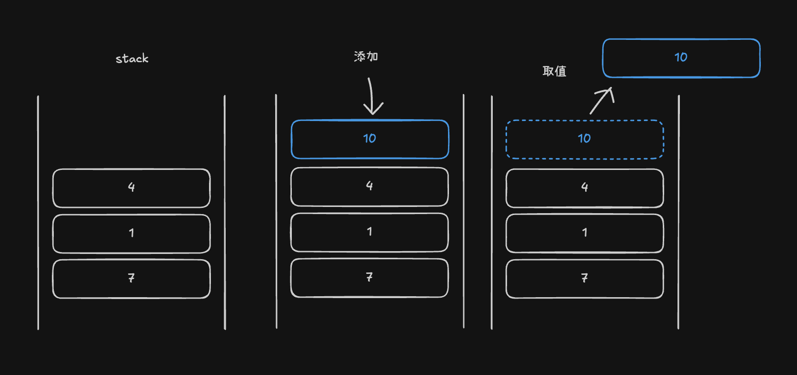

`stack` 是一個資料結構，以 FILO (first in last out) 來處理資料，也就是最後存進去的資料第一個出來



## 宣告

```cpp
stack<int> s; 
```

## 基礎運算

每個時間複雜度皆為 $O(1)$

添加一個值
```cpp
s.push(x); 
```

取得最上面的值
```cpp
int x=s.top(); 
```

把最上面的去除 
```cpp
s.pop(); 
```

取得大小
```cpp
int sz=s.size(); 
```

是否為空
```cpp
bool e=s.empty(); 
```

## 注意

- `top()` 和 `pop()` 如果 `stack` 為空，會 `RE` ，需要先確認 `!s.empty()`
- `pop()` 不回傳值，要用 `top()` 讀取
- 沒有辦法迴圈 `stack` 中的元素，如果要，必須用 `vector` 寫