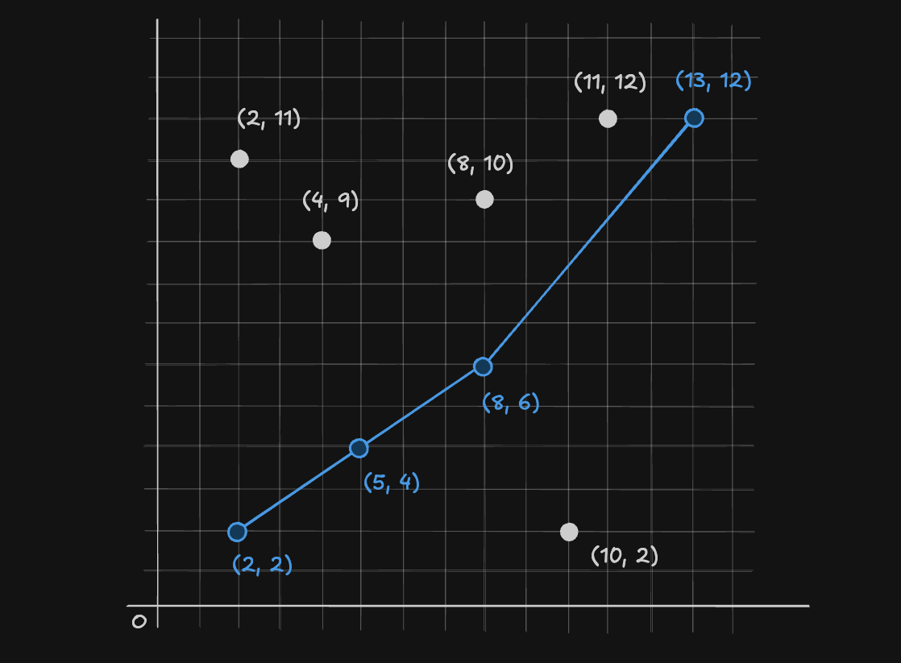

這是 2026 年學科能力競賽彰化雲林嘉義區的分區賽題目、解答及心得。本人比賽中寫的挺菜。

題目名稱和介紹都是我記得的，應該不會對很多，我覺得至少我題目寫的不會比比賽的差 :) 實際上的題目應該會比我寫的冗長一點，但不至於讀不懂

> 今年的教授會用 $\LaTeX$ 還是十分值得慶祝的一件事吧？測資還變多了，挺不錯的 

## 分數

- Q1~Q4: 15 分 （15 筆測資）
- Q5, Q6: 20 分 （10 筆測資）
- 最後排名：100, 91, 88, 82（好幾個），前 4 會進全國

# Q1: 尋寶遊戲

## 題目

小明參加了一個尋寶遊戲，從整個路的最左邊，他每次往右移動一個（最一開始那格也算），一開始他有 $0$ 個金幣

有幾種狀況：

- 他踩的格子是正數，他獲得那麼多個金幣
- 他踩的格子是負數，他減少那麼多金幣，最多只能減少到 $0$
- 他踩到 `*`，接下來 $5$ 格，他所增加/減少的金幣數 $\times 2$，注意：就算他沒有踩到增加減少金幣的，也算一格，如果效果內踩到，效果結束，重新開始 $5$ 格
- 他踩到 `@`，遊戲便結束，之後不管踩到什麼都不算
- 他踩到 $0$ 或其他不是整數的東西，記為沒有用處

請問，在遊戲結束時，小明有多少個金幣？

## 輸入

一行，是整個遊戲的道路，每一格由一個空白分隔

## 輸出

一個整數，最後小明的金幣數

## 範圍

沒有給：）

## 範例

input: 
```
1 4 -2 * 3 20 -5 0 @ 100 3
```

output: 
```
39
```

## 程式

寫一個確認字串是否為整數的程式 `strtoint` ，同時轉換為 `int` 

這題不難，十分簡單，實戰中不能有問題，我寫的時候一開始一直想說判斷字串是不是整數是什麼，想不起來只好自己寫，比完才知道沒有這東西，用 `try-catch` 應該可以，只要注意有沒有整個字串都拿，沒有試過

我比賽中是寫一個判斷的，然後用 `stoi` 換成 `int`，我只拿了 $14/15$ ，不知道是不是 `stoi` 會有問題，另一個人說不是用 `stoi` 有滿分，有一個跟我一樣用 `stoi` 也是 $14$ 分，無法得知原因。

```cpp=
#include <bits/stdc++.h>
using namespace std;

int strtoint(string s) {
    int n=s.size(); 
    bool neg=false; 
    int x=0; 
    for (int i=0; i<n; i++) {
        if (i==0 && s[i]=='-' && n>1) {
            neg=true; 
            continue;
        }

        if (!isdigit(s[i])) {
            return 0; 
        } else {
            x=x*10+(s[i]-'0'); 
        }
    }

    return neg ? -x : x; 
}

int main() {
    ios::sync_with_stdio(false);
    cin.tie(nullptr);

    string s;

    bool ended=false; 

    int money=0; 
    int d=0; 

    while (cin>>s) {
        if (s=="@") ended=true; 

        if (ended) continue;

        if (s=="*") {
            d=5; 
            continue; 
        }

        int x=strtoint(s); 

        if (d>=1) {
            d--; 
            money+=x*2; 
        } else {
            money+=x; 
        }
        
        money=max(money, 0); 
    }

    cout<<money<<'\n'; 

    return 0;
}
```


> complexity: 
> - time: $O(N)$ (他沒有給 $N$ ，反正會過)
> - space: $O(1)$

# Q2: 太空人多重？

## 題目 

在不同的星球上，重力會不一樣，因此在不同行星上測出來的重量可能會不一樣，導致我們不知道那個人的質量到底是多少。

但我們知道: 

$重量 = 質量 \times 重力$

也可以推導出

$質量 = 重量 \div 重力$

以下是各個星球的名稱及他們的重力: 

| 行星    | 重力 |
| ------- | ---- |
| Mercury | 0.39 |
| Venus   | 0.90 |
| Earth   | 1.00 |
| Mars    | 0.39 |
| Jupiter | 2.53 |
| Saturn  | 1.07 |
| Uranus  | 0.89 |
| Neptune | 1.14 |

一個科學家知道了 $8$ 個太空人分別在八大行星上（順序不一定）的名字、測出來的重量、所在的行星

他想要知道誰的質量最重（四捨五入至小數第二位），請幫他找出來。

## 輸入

$8$ 行，每一行依序有太空人的名字、測出來的重量、行星名字 

## 輸出

質量最大的太空人，名字、所在行星、實際質量（四捨五入至小數點後兩位）

如果四捨五入後有兩個以上一樣，就都輸出，分行

## 範圍

- 太空人名字長度 $\le 20$
- 測出來的重量 $\le 1000$ 且為兩位小數
- 行星名字如表格是大寫開頭

## 範例

input:
```
Jimmy 51.05 Earth
Grace 55.86 Neptune
Carol 18.72 Mars
David 96.14 Jupiter
Alice 19.91 Mercury
Frank 44.50 Uranus
Bob 45.00 Venus
Emma 52.43 Saturn
```

output: 
```
Jimmy Earth 51.05
Alice Mercury 51.05
```

## 程式

這題就是這樣，十分簡單，比較要注意是可能會有人一直想不到怎麼四捨五入到小數點後兩位，內建沒有，簡單的 `x=round(x*100)/100` 就可以了，不用想的太複雜

這題我寫的時候不知道有 `cout<<fixed<<setprecision(2);` 可以用，我還自己寫了一個會在小數後面補 `0` 的

然後我聽說其他學校有人星球用很多 `else if` 的，我是不建議啦：）

```cpp=
#include <bits/stdc++.h>
using namespace std;

int main() {
    ios::sync_with_stdio(false);
    cin.tie(nullptr);

    map<string, double> g; 

    g["Mercury"]=0.39; 
    g["Venus"]=0.90; 
    g["Earth"]=1.00; 
    g["Mars"]=0.39; 
    g["Jupiter"]=2.53; 
    g["Saturn"]=1.07; 
    g["Uranus"]=0.89; 
    g["Neptune"]=1.14; 

    vector<pair<double, pair<string, string>>> a; 

    double m=0; 

    for (int i=0; i<8; i++) {
        string name, planet;
        double weight; 
        
        cin>>name>>weight>>planet; 

        double mass=weight/g[planet]; 
        mass=round(mass*100)/100; // 取小數點後兩位

        m=max(m, mass); 

        a.push_back({mass, {name, planet}}); 
    }

    cout<<fixed<<setprecision(2); // 確定輸出會有兩位

    for (int i=0; i<8; i++) {
        if (a[i].first==m) {
            cout<<a[i].second.first<<' '<<a[i].second.second<<' '<<a[i].first<<'\n'; 
        }
    }

    return 0;
}
```

> complexity: 
> - time: $O(1)$ 
> - space: $O(1)$ 

# Q3: 晶片製造

## 題目

有個工程師想要造晶片，但是一個大塊的晶片上有些瑕疵，他要避開這些瑕疵，想知道有多少種切割出正方形晶片的方法。

他拿到了一個 $N \times M$ 的大晶片，其中每一個單位都是這兩個其中之一：

- `#` 可以用的
- `-` 有瑕疵的，要跳過

舉例來講，一個 $5 \times 4$ 的晶片

```
####
####
####
#--#
##--
```

中間就有 $4$ 個瑕疵

這時這個工程師就算總共有幾個可能在這之中切出的小正方形

以剛剛的晶片為例：

- $1 \times 1$ 的有 $16$ 個擺放的地方
- $2 \times 2$ 的有 $6$ 個擺放的地方
- $3 \times 3$ 的有 $2$ 個擺放的地方
- $4 \times 4$ 的有 $0$ 個擺放的地方

所以可能性是 $16+6+2+0=24$ 

## 輸入

第一行有兩個整數 $N, M$ 代表晶片的大小

接下來是晶片本身

> 他題目本身沒有講 N 還是 M 是行數，正確的是 N 為行數 

## 輸出

輸出一個數，總共的可能數

## 範圍

$N, M \le 100$ 

## 範例

input: 
```
6 8 
########
########
##-#####
#####--#
##--####
##--####
```

output: 
```
63
```

## 程式

這題一看到 $N, M \le 100$ 就可以直接暴力，沒有任何問題

```cpp=
#include <bits/stdc++.h>
using namespace std;

int main() {
    ios::sync_with_stdio(false);
    cin.tie(nullptr);

    int N, M; cin>>N>>M; 

    vector<vector<bool>> g(N, vector<bool> (M, true)); 

    for (int i=0; i<N; i++) {
        string s; 
        cin>>s; 
        for (int j=0; j<M; j++) {
            if (s[j]=='-') g[i][j]=false; 
        }
    }

    int sm=min(N, M); 
    int res=0; 

    for (int sz=1; sz<=sm; sz++) {
        for (int x=0; x<N-sz+1; x++) { 
            for (int y=0; y<M-sz+1; y++) { 
                bool pos=true; 
                
                for (int cx=0; cx<sz; cx++) {
                    for (int cy=0; cy<sz; cy++) {
                        if (!g[x+cx][y+cy]) {
                            pos=false; 
                            break; 
                        }
                    }
                    if (!pos) break; 
                }

                if (pos) res++; 
            }
        }
    }

    cout<<res<<'\n'; 

    return 0;
}
```

> complexity: 
> - time: $O(NM \cdot min(N, M)^3)$
> - space: $O(NM)$

# Q4: 斜率計算

> 注意：這題我寫的方法是用斜率最小的最遠點為 $M_k$ 但我其實忘記題目有沒有說要用最遠的，也忘記我比賽是寫用哪個點了

今天在一個二維的坐標系中，給你 $K$ 個點的 $x, y$ 座標，每個點都在不同位置

我們首先選擇 $x$ 最小的點 （$x$ 相同就選 $y$ 小的）作為 $M_s$ 

接下來選擇 $x$ 最大的點 （$x$ 相同就選 $y$ 大的）作為 $M_e$ 

在剩下的點中，我們要找出一個點 $M_k$，符合以下條件：

- $\overline{M_s M_k}$ 的斜率為正，且為最小的
- $\overline{M_k M_e}$ 的斜率為正
- $M_k$ 的 $x, y$ 跟 $M_s, M_e$ 的 $x, y$ 不重複

輸出 $\overline{M_s M_k}$ 上的所有點以及 $M_e$

如下圖，$M_s$ 為 $(2, 2)$，$M_e$ 為 $(13, 12)$，$M_k$ 為 $(8, 6)$



## 輸入

第一行爲一個數 $K$ 代表總共的點數量

接下來 $K$ 行，每行兩個數 $P_x, P_y$ 分別為那個點的 $x, y$ 座標

## 輸出

輸出 $\overline{M_s M_k}$ 上的所有點以及 $M_e$ （注意: $\overline{M_s, M_k}$ 上可能不只他們兩個點）

如果找不到的話，輸出 `Not found`

## 範圍

$3 \le K \le 1000$ 

$0 \le P_x, P_y \le 10000$

## 範例

input: 
```
9
2 11
8 10
10 2
2 2
4 9
11 12
5 4
13 12
8 6
```

output: 
```
2 2
5 4
8 6
13 12
```

## 程式

這題就真的算出來，題目需要讀一下，沒有很難懂，但我只拿 $11/15$ 我猜應該是判斷哪一個點出問題，因為我其實不記得斜率一樣要輸出哪個，我好像是都輸出，理論上 `double` 在這個範圍不會出現斜率一樣算出來不一樣的，如果範圍大一點，可能要用交叉相乘的。

```cpp=
#include <bits/stdc++.h>
using namespace std;

using pii=pair<int, int>; 

int main() {
    ios::sync_with_stdio(false);
    cin.tie(nullptr);

    int N; cin>>N; 

    vector<pii> pt(N); 
    for (auto &[x, y] : pt) cin>>x>>y; 

    sort(pt.begin(), pt.end()); 
    pii ms=pt[0]; 
    pii me=pt[N-1]; 

    double sm=numeric_limits<double>::max(); 

    vector<pii> mk; 

    for (int i=1; i<N-1; i++) {
        pii cur=pt[i]; 
        if (cur.first<=ms.first || cur.second<=ms.second || cur.first>=me.first || cur.second>=me.second) continue;

        double m=(double)(cur.second-ms.second)/(cur.first-ms.first); 

        if (m==sm) {
            mk.push_back(cur); 
        } else if (m<sm) {
            sm=m; 
            mk={cur}; 
        }
    }

    if (mk.empty()) {
        cout<<"Not found\n"; 
        return 0; 
    }

    sort(mk.begin(), mk.end()); 

    cout<<ms.first<<' '<<ms.second<<'\n'; 
    for (auto &[x, y] : mk) cout<<x<<' '<<y<<'\n'; 
    cout<<me.first<<' '<<me.second<<'\n'; 

    return 0;
}
```

> complexity: 
> - time: $O(K log K)$
> - space: $O(K)$

# Q5: 小明借錢

## 題目

小明沒錢了，他跟一家銀行借錢，方案是這樣的，銀行給了一個 $R$ 值：

- 每個月，欠的錢原本是 $W$，會變成 $W + W/R$ （無條件進位）
- 再加上利息之後，小明可以還錢，如果需要還的都還了，就沒有欠債了

你知道了銀行的 $R$ 值，及小明有 $N$ 個月的時間，你也知道他在這些月份分別會還多少錢，作為他的財務顧問，幫他找出最多可以借多少錢，確保他在最後一個月或之前將所有欠債還完

例如，$N = 6$、$R = 10$，六個月分別可以還 $30$、$40$、$50$、$35$、$60$、$46$

借 $182$ 元的情況如下，可以剛好還完

| 月份 | 原本的欠款 | 利息 | 加上利息之後的欠款 | 還的錢 | 剩下的欠款 |
| ---- | ---------- | ---- | ------------------ | ------ | ---------- |
| 1    | 182        | 19   | 201                | 30     | 171        |
| 2    | 171        | 18   | 189                | 40     | 149        |
| 3    | 149        | 15   | 164                | 50     | 114        |
| 4    | 114        | 12   | 126                | 35     | 91         |
| 5    | 91         | 10   | 101                | 60     | 41         |
| 6    | 41         | 5    | 46                 | 46     | 0          |

如果再多借 $1$ 元，也就是借 $183$ 元，就沒有辦法還完了

| 月份 | 原本的欠款 | 利息 | 加上利息之後的欠款 | 還的錢 | 剩下的欠款 |
| ---- | ---------- | ---- | ------------------ | ------ | ---------- |
| 1    | 183        | 19   | 202                | 30     | 172        |
| 2    | 172        | 18   | 190                | 40     | 150        |
| 3    | 150        | 15   | 165                | 50     | 115        |
| 4    | 115        | 12   | 127                | 35     | 92         |
| 5    | 92         | 10   | 102                | 60     | 42         |
| 6    | 42         | 5    | 47                 | 46     | 1          |

所以答案是 $182$ 元

## 輸入

第一行有兩個數 $N, R$ 月數及銀行給的利息計算值

第二行有 $N$ 個數字，分別是小明每個月還的錢

## 輸出

輸出一個數字，小明最多可以借多少錢

## 範圍

$1 \le N \le 10000$

$1 \le R \le 10000$

$1 \le K_x \le 10000$ ( $K_x$ 為在第 $x$ 個月還款金額，$1 \le x \le N$ )

## 範例

input: 
```
6 10
30 40 50 35 60 46
```

output: 
```
182
```

## 程式

因為最大的答案差不多可以到 $N \cdot K_x$，也就是 $10^8$ ，所以寫個二分搜

這題我寫得很順，然後一開始沒看到無條件進位，小問題

這題有人寫暴力一個一個算拿到 $16/20$ ：/

然後我現在寫才發現我沒有寫到避免要還的錢超過 `long long` 的 `break`，但我還是滿分，可見測資不怎麼好 

```cpp=
#include <bits/stdc++.h>
using namespace std;

int main() {
    ios::sync_with_stdio(false);
    cin.tie(nullptr);

    int N, R; cin>>N>>R;
    vector<int> a(N); 
    for (int &x : a) cin>>x; 

    long long l=0, r=1e8; 

    while (r!=l+1) {
        long long mid=(r+l)/2; 

        long long cur=mid; 

        bool pos=false; 

        for (int i=0; i<N; i++) {
            cur=cur+(cur+R-1)/R; 
            cur-=a[i]; 

            if (cur<=0) {
                pos=true; 
                break; 
            } 

            if (cur>1e8) break; // 避免因為 R 過小而大幅度的增加
        }

        if (pos) {
            l=mid; 
        } else {
            r=mid; 
        }
    }

    cout<<l<<'\n'; 

    return 0;
}
```

> complexity:
> - time: $O(N log A)$ ( $A$ 為二分搜上限)
> - space: $O(N)$

# Q6: 行星旅行

## 題目

今天有一個外星人想要從他現在在的星球到另一個星球，我們知道每一個星球的座標，但在兩個星球之間移動有這些規則

- 兩個星球的距離不可以超過 $MaxD$（距離可以用兩個星球座標算 $d=\sqrt{(x_1-x_2)^2+(y_1-y_2)^2}$）
- 兩個星球的連線不可以碰到太陽，太陽為在 $(0, 0)$ 半徑為 $SunR$ 的圓（注意：是線段不能碰到，延伸線沒有關係）
- 總共不可以移動超過 $K$ 次（從一星球到另一星球）

從一個星球 $S$ 到星球 $T$ 的花費是兩個星球的距離平方，也就是 $d^2 = (x_S-x_T)^2+(y_S-y_T)^2$。整趟旅行的總花費是每次移動的花費加總，因此有可能經過一個星球會比直接到達花費更少

例如：$SunR = 10$、$MaxD = 50$、$K = 2$，要從 $(20, 20)$ 到 $(60, 20)$，直接飛的距離是 $40$，花費是 $40^2 = 1600$

但如果先到 $(40, 20)$ 再到 $(60, 20)$，兩段的距離都是 $20$，總花費是 $20^2 + 20^2 = 800$，比直接飛的 $1600$ 更少。這兩種走法都不會碰到太陽，每次移動的距離也都不超過 $MaxD$，且最多只移動 $2$ 次

聰明的你知道太陽系中每個行星跟太陽遠近依序是：$Mercury$, $Venus$, $Earth$, $Mars$, $Jupiter$, $Saturn$, $Uranus$, $Neptune$
，你可以透過與太陽的距離來知道座標對應的是哪顆行星

## 輸入

第一行有三個數字 $SunR, MaxD, K$ 

第二行有兩個字，分別是起點的行星名稱和終點的行星名稱

接下來有 $8$ 行，分別是行星的 $x, y$ 座標

## 輸出

輸出一個小數（四捨五入至小數點第二位），是最少需要的花費

如果沒有找到方法，輸出 `UNREACHABLE`

## 範圍

$SunR \le 10$

$MaxD \le 100$ 

$K \le 7$

$x, y \le 10000$

其中，$SunR, MaxD$ 為小數，到小數點後四位

## 範例

input: 
```
9.2500 52.7500 3
Earth Saturn
-70 0
0 -15
30 0
-40 40
-22 0
60 60
0 40
-60 -80
```

output: 
```
4138.00
```

## 程式

這題難的在於要判斷是否會碰到太陽，我比賽當下一直寫不好，點線距我明明有記得

這題是這場最難的，一個解出來而已，其實不是難，就麻煩，又壓軸

我給的程式是用 Dijkstra，其實窮舉也會過

然後這題我有用 `EPS` 來避免 `double` 有誤差，比賽中應該不用，畢竟他們的測資就那樣

```cpp=
#include <bits/stdc++.h>
using namespace std;

using pdd=pair<double, double>; 

int main() {
    ios::sync_with_stdio(false);
    cin.tie(nullptr);

    double sunR, maxD; 
    int K; 
    cin>>sunR>>maxD>>K; 

    string s, t; cin>>s>>t; 

    vector<pdd> pt(8); 
    for (auto &[x, y] : pt) cin>>x>>y; 

    // 依照與太陽的距離排序
    sort(pt.begin(), pt.end(), [](pdd a, pdd b) {
        return a.first*a.first+a.second*a.second < b.first*b.first+b.second*b.second; 
    }); 

    vector<string> names={"Mercury", "Venus", "Earth", "Mars", "Jupiter", "Saturn", "Uranus", "Neptune"}; 
    int st=find(names.begin(), names.end(), s)-names.begin(); 
    int ed=find(names.begin(), names.end(), t)-names.begin(); 

    // 合法的線段
    vector<vector<pair<int, double>>> adj(8); 

    for (int i=0; i<8; i++) {
        for (int j=0; j<8; j++) {
            if (i==j) continue; 

            auto [ax, ay]=pt[i]; 
            auto [bx, by]=pt[j]; 

            double dx=bx-ax, dy=by-ay; 
            double d2=dx*dx+dy*dy; 

            if (d2>maxD*maxD) continue;

            double tt=-(ax*dx+ay*dy)/d2; 
            tt=max(0.0, min(1.0, tt)); 
            
            constexpr double EPS=1e-9;

            double px=ax+tt*dx, py=ay+tt*dy; 
            if (px*px+py*py<=sunR*sunR+EPS) continue; 

            adj[i].push_back({j, d2}); 
        }
    }

    // dijkstra {花費, {行星, 步數}}
    priority_queue<pair<double, pair<int, int>>, vector<pair<double, pair<int, int>>>, greater<>> pq; 

    pq.push({0, {st, 0}}); 

    while (!pq.empty()) {
        auto [d, cur]=pq.top(); pq.pop(); 
        auto [u, k]=cur; 

        if (u==ed) {
            cout<<fixed<<setprecision(2)<<d<<'\n'; 
            return 0; 
        }

        if (k==K) continue; 

        for (auto [v, w] : adj[u]) pq.push({d+w, {v, k+1}}); 
    }

    cout<<"UNREACHABLE\n"; 

    return 0;
}
```

> complexity
> - time: $O(7^K \cdot K)$
> - space: $O(7^K)$